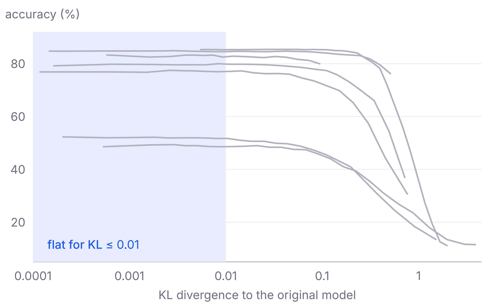
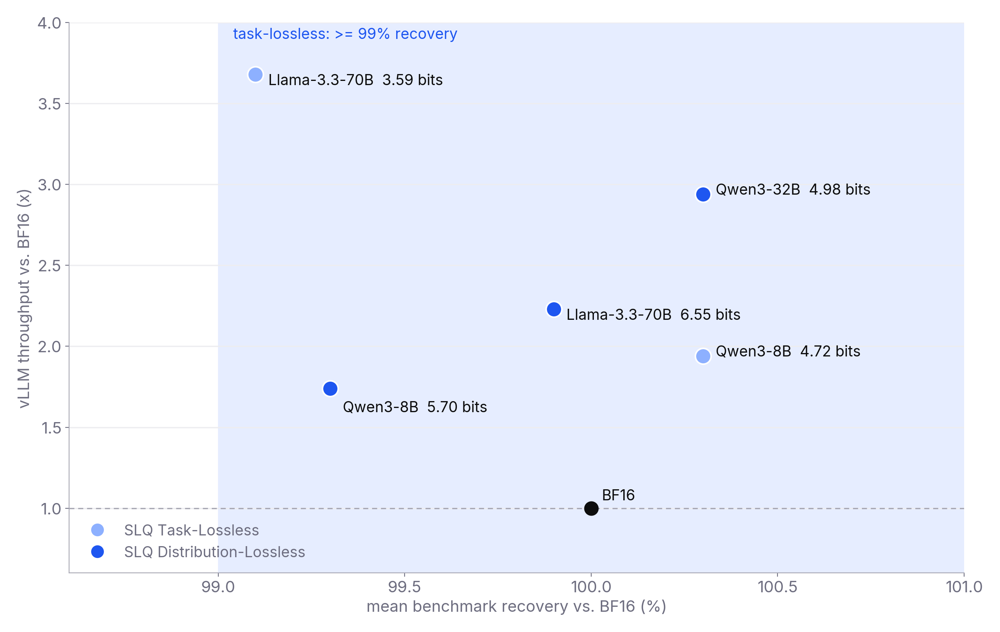
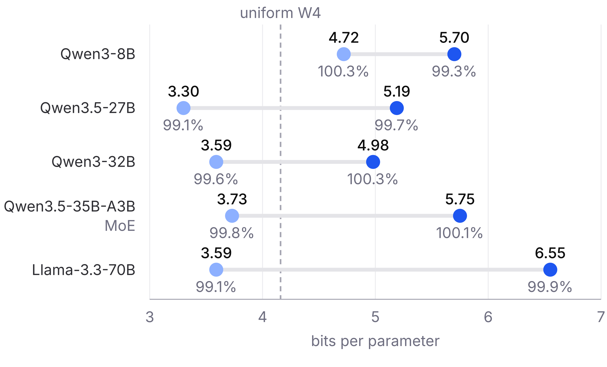
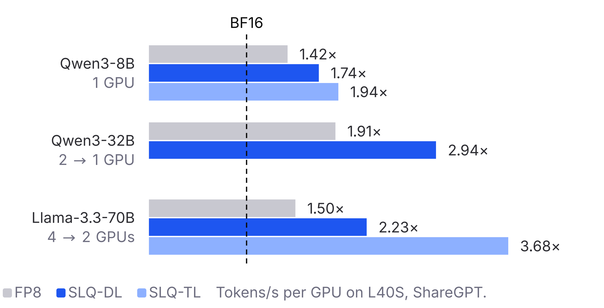

# SLQ

[](https://arxiv.org/abs/2605.02404)
[](https://openreview.net/forum?id=Xq1atP3a6S)

Code for [**Statistically-Lossless Quantization of Large Language Models**](https://openreview.net/forum?id=Xq1atP3a6S) (Helcig, Kurtic, Alistarh; COLM 2026).

SLQ finds the lowest-bitwidth non-uniform weight quantization that meets an explicit fidelity target:

- **Task-Lossless (TL)**: mean zero-shot benchmark recovery >= 99% of BF16, i.e. within the sampling variance of the BF16 model. Reached at 3.3-4.7 bits per parameter.
- **Distribution-Lossless (DL)**: the next-token distribution matches BF16, measured by the Expected Acceptance Rate (EAR >= 0.99; 0.985-0.99 depending on the model in the paper experiments). Reached at 5.0-6.6 bits per parameter.

<p align="center">
  
  
</p>

Left: zero-shot accuracy stays flat while the KL divergence to the original model is below about 0.01 and drops once it grows well beyond that (weight-noise sweep over seven models from 0.6B to 70B parameters, paper Figure 1b and App. C.5). Right: every SLQ model keeps >= 99% of the BF16 benchmark accuracy while serving 1.7-3.7x faster in vLLM (recovery from Table 1, ShareGPT tokens/s per GPU on L40S from Table 3).

Pipeline: layer-wise GPTQ at every bitwidth in {2,...,8} (asymmetric INT, group size 128), multi-bitwidth Shapley sensitivity estimation, and an ILP over the resulting cost table, binary-searched down to the target. Served with the [Humming](https://github.com/inclusionAI/humming) kernels in vLLM, the SLQ models reach 1.7-3.7x TPS/GPU over BF16 (paper Table 3).

Method details are in the [paper](https://openreview.net/forum?id=Xq1atP3a6S); [`scripts/README.md`](scripts/README.md) lists the wrapper scripts for every stage.

## Results

<p align="center">
  
  
</p>

Left: bits per parameter of the Task-Lossless (light) and Distribution-Lossless (dark) configurations, with mean recovery vs. BF16 below each point (Table 1, Table 6). Right: end-to-end vLLM throughput relative to BF16 on L40S GPUs, ShareGPT workload (Table 3).

## Installation

```bash
pip install -r requirements.txt
pip install -r eval/requirements_lmeval.txt   # lm-eval benchmarks (Table 1, slq_search_tl.py)
```

Python 3.10+ (tested with 3.12) and CUDA GPUs. Serving the `humming_online` checkpoints needs a vLLM build with the Humming kernels.

## Usage

Four stages, each with a Python entry point in the repo root and a wrapper in `scripts/`. The stage wrappers forward extra arguments to the Python entry point and are run from the repository root.

### 1. Quantize

GPTQ at every bitwidth in {2,...,8}. For each (layer, bitwidth) it writes fake-quantized weights (`.pth`, read by the search) and a `_qparams.pt` bundle (read by `eval/run_humming_speedup.py`).

```bash
scripts/run_gptq.sh Qwen/Qwen3-8B /path/to/slq 8   # 8 GPUs (torchrun)

# Output goes to <save_dir>/<model_name>/<calibration_bitwidth>bit/; every later stage takes it as LAYER_DIR.
LAYER_DIR=/path/to/slq/Qwen3-8B/4bit
```

### 2. Build the sensitivity database

Linear and multi-bitwidth Shapley estimation (Algorithm 1) on 512 x 2048 FineWeb-Edu calibration tokens, top-K = 10:

```bash
scripts/run_build_database.sh Qwen/Qwen3-8B "$LAYER_DIR"
```

The searches pick up the `shapley_*.json` file in `LAYER_DIR` automatically and stop with an error if there are several; pass `--shapley-db` in that case (`slq_search_dl.py --sensitivity-method linear` reads `linear_*.json`, or `--linear-db`).

### 3. Search

**Distribution-Lossless.** Lowest average bitwidth with EAR >= 0.99. By default every binary-search step measures EAR with one forward pass on the calibration set; `--use-predicted-constraints` uses the EAR predicted from the cost table instead (the procedure of paper Sec. 3.3, no model inference).

```bash
scripts/run_search_dl.sh Qwen/Qwen3-8B "$LAYER_DIR" 0.99
```

**Task-Lossless** via single-point calibration (Algorithm 2). It needs one measured anchor: the mean benchmark recovery vs. BF16 of the uniform 4-bit model built from the same `LAYER_DIR` (the model whose KL the search measures).

```bash
# uniform 4-bit anchor from LAYER_DIR (written to /path/to/checkpoints/Qwen3-8B/uniform4)
scripts/run_build_checkpoint.sh Qwen/Qwen3-8B "$LAYER_DIR" 4 /path/to/checkpoints --quant-format fake
scripts/run_lmeval.sh Qwen/Qwen3-8B results/Qwen3-8B-bf16
scripts/run_lmeval.sh /path/to/checkpoints/Qwen3-8B/uniform4 results/Qwen3-8B-uniform4

scripts/run_search_tl_calibrated.sh Qwen/Qwen3-8B "$LAYER_DIR" \
    results/Qwen3-8B-bf16/results.json results/Qwen3-8B-uniform4/results.json 0.99
```

The search minimizes the KL Shapley costs and accepts a budget once the calibrated KL prediction is below the threshold implied by the target recovery; it needs two forward passes and no benchmark runs beyond the anchor. A guardrail rejects the result if the measured-to-predicted KL ratio drifts by more than 2x (paper Sec. 3.3). `scripts/run_search_tl.sh` is a benchmark-in-the-loop variant that runs the lm-eval suite at every binary-search step (expensive, useful for validation).

**Other allocation solvers.** The binary search is independent of how each budget is allocated; the ILP over the Shapley cost table is the fast default. Our newer [RCO](https://github.com/IST-DASLab/RCO) (Riemannian Constrained Optimization, [Helcig and Alistarh, 2026](https://arxiv.org/abs/2605.00649)) can replace it: it optimizes the true model loss at an exact bitwidth budget instead of an additive per-layer proxy, which is slower but more accurate (paper Sec. 3.3). RCO reads the same `<layer>/<bits>.pth` layer store, so `LAYER_DIR` can be passed to `rco_search_quant.py --layer-dir` at each candidate budget, and its per-layer assignment evaluated with the same EAR / calibrated-KL check.

Both searches write a `config_*.txt` with the per-layer bitwidths into `LAYER_DIR`. To report bits per parameter including the scale/zero-point overhead (paper Table 7, App. F), add `--bitwidth-map "2:2.156,3:3.156,4:4.156,5:5.156,6:6.156,7:7.156,8:8.156"`.

### 4. Build and serve a checkpoint

```bash
scripts/run_build_checkpoint.sh Qwen/Qwen3-8B "$LAYER_DIR" "$LAYER_DIR/config_<...>.txt" /path/to/checkpoints
```

Both formats store the GPTQ weights fake-quantized in BF16 plus a model card. The default `--quant-format humming_online` adds `humming_online_quant_config.json` and a `serve.sh` launcher; the Humming vLLM build packs the weights to their per-layer bitwidths on load. `--quant-format fake` writes only the fake-quantized checkpoint, for stock vLLM or transformers.

```bash
cd /path/to/checkpoints/Qwen3-8B/<config_name>
./serve.sh   # vLLM + Humming kernels on port 7000
```

## Evaluation

| Script                         | Measures |
|--------------------------------|----------|
| `eval/run_lmeval.py`           | zero-shot benchmarks, non-greedy over 3 seeds (Tables 1, 4) |
| `eval/run_ear.py`              | EAR and top-K KL of `config_*.txt` / uniform configs on the calibration set (Table 5 SLQ row, App. G.1) |
| `eval/run_kl.py`               | top-K KL and EAR of a checkpoint vs. its base model on the calibration set |
| `eval/run_ppl.py`              | perplexity on wikitext2 / c4 / fineweb_edu |
| `eval/run_humming_speedup.py`  | model-level Humming vs. BF16 forward speed (no direct paper figure) |

The Uniform-4 rows of Table 1 (asymmetric g128, 4.16 bpp) are the `uniform4` checkpoint built in stage 3. Table 6 (MoE) uses the lm-eval log-likelihood protocol, which `eval/run_lmeval.py` does not implement; run `lm_eval` directly on the checkpoint with the tasks `arc_easy,arc_challenge,hellaswag,piqa,winogrande,mmlu,gsm8k`.

## Citation

```bibtex
@inproceedings{helcig2026slq,
  title     = {Statistically-Lossless Quantization of Large Language Models},
  author    = {Michael Helcig and Eldar Kurtic and Dan Alistarh},
  booktitle = {Conference on Language Modeling (COLM)},
  year      = {2026},
  url       = {https://arxiv.org/abs/2605.02404},
}
```

See also [`CITATION.cff`](CITATION.cff).

## License

Apache-2.0, see [`LICENSE`](LICENSE).

## Acknowledgements

The GPTQ implementation in `src/quant/` is adapted from [EvoPress](https://github.com/IST-DASLab/EvoPress) (Sieberling et al., 2025). Inference uses the [Humming](https://github.com/inclusionAI/humming) kernel library by Jinzhen Lin and the Venus Team, Ant Group.
